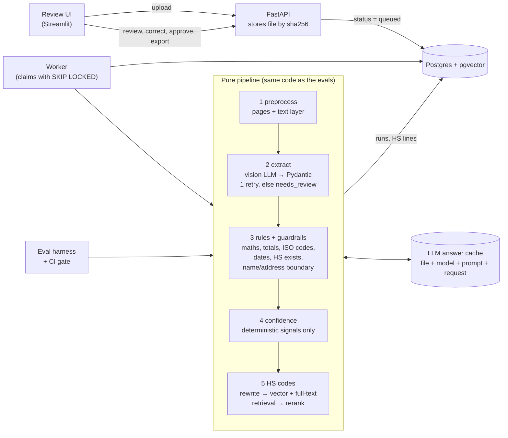

# TradeDoc AI

TradeDoc AI reads commercial invoices (PDFs or phone photos) and turns them into validated, structured data. A vision LLM extracts the fields. Deterministic code then checks them, and a reviewer approves the result before export. The system also suggests Pakistan Customs Tariff (PCT) codes for each line, using retrieval over the official tariff plus an LLM reranker.

**The point of the project is evals and guardrails, not the UI.** Every change is measured on labelled data. The numbers below come from versioned reports in [`evals/reports`](evals/reports), and [`evals/CHANGELOG.md`](evals/CHANGELOG.md) records what changed between runs and why.

It is built for a freight-forwarding business (H & J Corporation), where clearing agents re-type invoice data into customs filings and quotes.

**Live demo:** a Hugging Face Space (the link is added here after the first deploy). Upload **synthetic documents only**; uploads are deleted within an hour, and upload counts are limited. The first load after a quiet spell may take a minute while the Space wakes up.

## How it works



- **The LLM proposes; code verifies.** Arithmetic, formats and cross-field checks are plain Python. A suggested HS code that wasn't retrieved from the tariff is rejected.
- **Explicit outcomes.** Every field is `ok`, `needs_review` or `failed_check`. A document without a text layer (a photo) sends its critical fields to a person, because nothing can verify them.
- **Reproducible.** Documents are addressed by sha256. Each LLM answer is cached by file, model, prompt version and the full request. Every result records model, prompt and schema versions.
- **Free tiers only.** Groq (`qwen/qwen3.8-27b` for extraction, `openai/gpt-oss-120b` for HS), local `bge-small` embeddings, Postgres with pgvector.

## Results

All results are on **synthetic invoices**: 9 layouts, generated with ground truth. They measure layout generalisation, not real-world accuracy. "Seen" layouts were available while prompts were tuned; "unseen" ones never were. Results are never blended across the two. The critical fields are invoice number, total, currency, Incoterm, buyer and consignee names, and every line amount.

### Extraction (`qwen/qwen3.8-27b`, prompt v3)

| Set | Layouts | Documents | Critical-field accuracy | All critical fields right |
| --- | --- | --- | --- | --- |
| Clean PDFs, dev: **a 27-document sample of the 53** | seen | 27 | 100% | 27/27 |
| Clean PDFs, test | unseen | 12 | 100% | 12/12 |
| Clean PDFs, test (`ledger`, made seen after its failures were read) | seen | 12 | 98.0% | 10/12 |
| Clean PDFs, held-out layout never used in tuning | unseen | 12 | 100% | 12/12 |
| Photos, dev | seen | 16 | 94.5% | 10/16 |
| Photos, test | unseen | 4 | 100% | 4/4 |
| Photos, test (`ledger`) | seen | 3 | 96.4% | 2/3 |
| Photos, held-out layout | unseen | 4 | 98.4% | 3/4 |

Before `ledger` was inspected, the test split was frozen at 99.1% critical-field accuracy (clean, 22/24 all right) and 98.8% (photos, 6/7). See the changelog.

### Guardrails (60 invoices with one planted error each; no LLM involved)

| Planted error | Caught | How |
| --- | --- | --- |
| Wrong line amount | 10/10 | quantity × unit price check |
| Wrong total | 10/10 | lines must sum to the total within rounding |
| Net weight over gross | 10/10 | weight check |
| Outdated Incoterm (e.g. DDU) | 10/10 | schema: closed list |
| Future invoice date | 10/10 | date check |
| Invalid currency | 10/10 | ISO-4217 check |
| **All** | **60/60** | |

False alarms: 0 of 113 correct invoices flagged, and 0 of 7,853 correct fields sent to review.

### Calibration (all cached v3 extractions; below 0.5 confidence a field goes to a person)

| Confidence | Clean PDFs: fields (accuracy) | Photos: fields (accuracy) |
| --- | --- | --- |
| 0.0–0.3 | 9 (22%) | 7 (43%) |
| 0.3–0.5 | 6 (0%) | 3 (100%) |
| 0.5–0.7 | 11 (100%) | 1,841 (97.4%) |
| 0.7–0.9 | 747 (100%) | — |
| 0.9–1.0 | 4,208 (100%) | — |
| **Wrong fields sent to a person** | **13/13** | **41/51** |
| **Correct fields sent to a person** | **2/4,968 (0.04%)** | **1,461/1,800 (81%)** |

On clean PDFs every field the system passed as `ok` was right. Photos have no text layer to check against, so most of their fields go to a person. That cost is deliberate, and it is the main limitation below.

### HS code suggestion (`openai/gpt-oss-120b`, 86 invoice-style lines)

**The gold codes have not yet been verified by a customs professional**; a sample is being checked. Read these numbers as provisional.

| Split | Lines | Retrieval recall@10 (6-digit) | Top-3, 4-digit | **Top-3, 6-digit** | Top-3, 8-digit PCT |
| --- | --- | --- | --- | --- | --- |
| Dev (tuned on) | 63 | 81.0% | 90.5% | **81.0%** | 77.8% |
| Test (run once, frozen) | 23 | 82.6% | 82.6% | **78.3%** | 73.9% |

Retrieval is the bottleneck. When the right code is among the 10 candidates, the reranker almost always puts it in its top 3. Two further steps raised dev retrieval recall from 81% to 94–97%: sending 30–50 candidates, and boosting the headings the query step predicts. Both are measured but not shipped, and planned for v1.1. Suggestions are only suggestions: a licensed person makes the final classification.

## Design rules

1. **The schema is the contract.** Every LLM output is parsed into Pydantic. Invalid output gets one retry with the errors, then `needs_review`.
2. **The LLM proposes, code verifies.** The model never does maths that matters.
3. **Constrain, don't trust.** HS codes come only from retrieved tariff rows, and enums from fixed lists.
4. **A pure pipeline.** No web, database or global state inside it; the API, worker, CLI and evals run the same functions.
5. **Explicit outcomes, no silent defaults.** `None` means "not found", never "failed".
6. **Version everything.** Model, prompt and schema versions go on every result, and a prompt change means a new file.
7. **Idempotent.** The document id is the file's sha256.
8. **Fail per stage.** A failed HS step never discards a good extraction.
9. **Documents are untrusted input.** Their text is data, never instructions; CSV exports neutralise spreadsheet formulas.
10. **Provider-agnostic.** The model is configuration.
11. **Boring infrastructure.** One app, one worker and one Postgres; no queue service until one is needed.
12. **Confidentiality.** Real documents are never committed or logged.

## Limitations

- **Synthetic data only.** 9 layouts by one author, which share fonts and label lists. A set of redacted real documents is the next step.
- **The extraction eval set is frozen and can't be regenerated.** Its pages were printed with Windows fonts; since 2026-11-25 the generator uses the open fonts in `synth/fonts`, so the same seed gives the same ground truth but different files. The exact files behind the extraction results are in the [`eval-data-v3` release](https://github.com/Salik-web/HsCode-FInder/releases/tag/eval-data-v3), as `tradedoc-eval-data-frozen-2026-11-25.zip` (SHA-256 `9dabce8079f609b7210202ed6935c8a39f17e597e70a3af653465bb56bbd48c0`). The recorded model answers are a second file there, `tradedoc-llm-cache-frozen-2026-11-25.zip` (SHA-256 `aa47fc01578dd51221d371e5ae3a274cd5888dfb87fbd14208efe39f65534b70`). **The exact scores replay on Windows only:** cache keys include the rendered page images, and PDFs render to different bytes on Linux, so PDF answers miss there (photos still hit). Elsewhere the model has to be called again.
- **HS is below target on test** (78.3% against 80%), and its gold codes are unverified.
- **Photos send about four fifths of their fields to review.** There is no OCR text layer to verify them against yet.
- **Charges and discounts** between subtotal and total aren't extracted yet (prompt v4), so the total check flags such invoices.
- **Two-page invoices** are tested only on seen layouts.
- **Generated text layers can differ slightly between systems.** Regenerated with the bundled fonts, 121 of 122 PDFs have the same text layer on Windows and Linux. `inv_00027` has a stray `k` line at the end of page 1 on Linux. The frozen eval data and the CI gate aren't affected.
- **Free-tier quotas.** Groq allows about 200,000 tokens a day per model, which is why the demo limits uploads.

## Using it with your own documents

**Before you start**

- **Commercial invoices only.** Packing lists and bills of lading aren't supported, and nothing checks the document type: one of those would be read as if it were an invoice. Files can be PDF, JPEG or PNG, up to 10 MB and 5 pages. An invoice with more than about 16 lines may not fit Groq's free-tier output limit.
- **HS codes are for Pakistan only.** Suggestions come from the Pakistan Customs Tariff (PCT 2026-27). They are suggestions for a customs professional to check, not a classification. Another country's tariff would need its own table and its own evaluation.
- **Accuracy is measured on synthetic invoices only**, never on real ones. Expect different results on yours, and review every document before you use it.
- **Your documents leave your machine.** Page images and extracted text go to Groq (or the provider you configure), so check that you are allowed to send them. Uploads stay in `storage/`, extracted data in Postgres, and model answers in `.cache/llm` (set `LLM_CACHE_ENABLED=false` to stop that last one). Outside demo mode nothing is deleted automatically, and there is no login: keep the API and the UI on your own machine.
- **Exact numbers need the frozen data.** The generator no longer produces the files behind the results above. They are in the [`eval-data-v3` release](https://github.com/Salik-web/HsCode-FInder/releases/tag/eval-data-v3).

**Set up** (Python 3.12, [uv](https://docs.astral.sh/uv/) and Docker)

1. Get a Groq API key at [console.groq.com](https://console.groq.com/keys); the free tier is enough to try it.
2. Copy `.env.example` to `.env`. Set `GROQ_API_KEY` and change `POSTGRES_PASSWORD`.
3. Start the database and install the app:

   ```bash
   uv sync
   docker compose up -d
   uv run alembic upgrade head
   ```

4. Load the tariff: 7,605 codes, embedded on your CPU (2 to 7 minutes). The first run downloads the embedding model from Hugging Face.

   ```bash
   uv run python -m tariff.ingest --csv tariff/pct_2026-27.csv --version 2026-27
   ```

5. Start each of these in its own terminal. Load the tariff first, because the worker reads the list of codes when it starts.

   ```bash
   uv run uvicorn app.api.main:create_app --factory
   uv run python -m app.worker
   uv run streamlit run ui/app.py --server.address 127.0.0.1
   ```

6. Open <http://localhost:8501>, upload an invoice, correct what is flagged, choose the HS codes, approve and export. On Groq's free tier, plan on about 30 invoices a day and about 120 lines with HS codes.

## Run it locally

Needs Python 3.12, [uv](https://docs.astral.sh/uv/) and Docker. Put API keys in `.env`; see `.env.example`.

```bash
uv sync
uv run playwright install chromium                  # only for generating synthetic invoices
docker compose up -d                                # Postgres + pgvector
uv run alembic upgrade head
uv run python -m tariff.ingest --csv tariff/pct_2026-27.csv --version 2026-27   # ~2 min

uv run uvicorn app.api.main:create_app --factory   # API on :8000 (docs at /docs)
uv run python -m app.worker                         # processes uploads
uv run streamlit run ui/app.py                      # review UI on :8501

uv run pytest                                       # tests; the LLM is always mocked
uv run python -m evals.gate                         # offline eval gate, as in CI
```

**Docker** (the demo image): `docker build -t tradedoc-ai .`, then run it with `DATABASE_URL` and `GROQ_API_KEY`. It migrates the database, embeds the tariff on a new database, seeds the sample invoices from the committed cache, and serves the UI on port 7860.

**CI.** GitHub Actions runs ruff and the tests (against a real Postgres), plus an offline eval gate. The gate replays a 20-document smoke set and the injected-error set from committed fixtures. It fails if critical-field accuracy drops by more than 2 points, if the guardrails catch less, or if a prompt changed without the evals being re-run.

To run the full evals on the data behind the results above, download `tradedoc-eval-data-frozen-2026-11-25.zip` from the [`eval-data-v3` release](https://github.com/Salik-web/HsCode-FInder/releases/tag/eval-data-v3), unzip it into `data/` and check it with `sha256sum -c SHA256SUMS`; then use the commands in `CLAUDE.md`. To replay the recorded answers without calling a model (Windows only), also unzip `tradedoc-llm-cache-frozen-2026-11-25.zip` into `.cache/`, check it the same way, and add `--offline`. `uv run python -m synth.generate --n 100 --messy 30 --seed 42` gives the same ground truth but overwrites `data/synthetic` with different pages and photos (see Limitations).

## Repository

| Path | What it holds |
| --- | --- |
| `app/pipeline/` | Pure pipeline: preprocess, extract, rules, validate, confidence, HS suggestion, review |
| `app/api/`, `app/worker.py`, `ui/` | FastAPI, the worker, the Streamlit review UI |
| `app/db/` | SQLAlchemy models, Alembic migrations, the pgvector index |
| `app/demo.py`, `app/retention.py`, `demo/` | Public demo: sample invoices with their cached answers, upload limits, deletion |
| `evals/` | Metrics, eval CLIs, CI gate and fixtures, reports, changelog, `hs_gold` |
| `synth/` | Synthetic invoice generator (layouts, rendering, photo noise, planted errors) |
| `tariff/` | PCT 2026-27 parser and the parsed table |
| `prompts/` | Versioned prompts; an old version is never edited |
| `Dockerfile`, `deploy/`, `.github/` | The demo image, its start script, CI and the manual deploy workflow |

## License

The code is under the [MIT License](LICENSE). The fonts in `synth/fonts` keep their own licences, in `synth/fonts/licenses`. The tariff table is parsed from the Pakistan Customs Tariff published by the Federal Board of Revenue.
